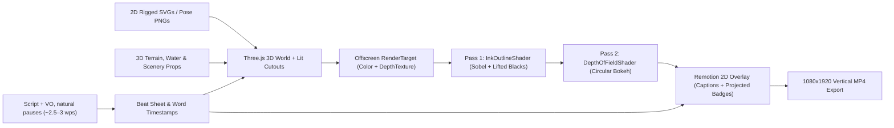
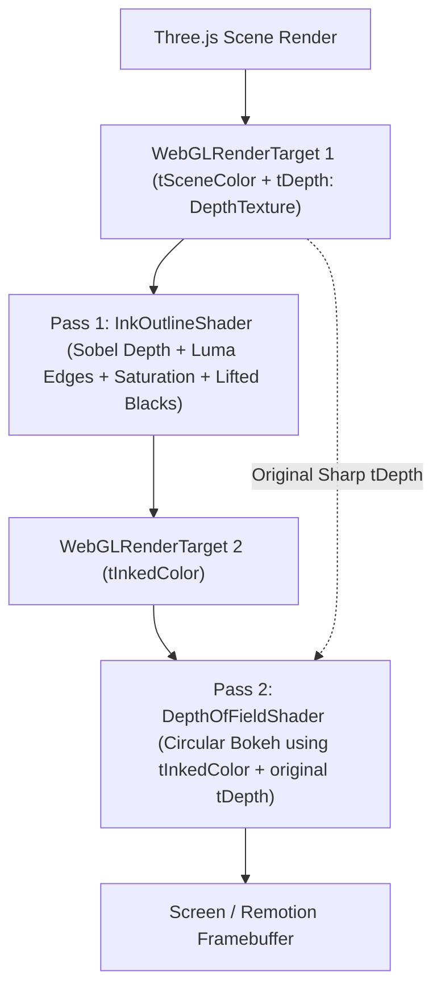
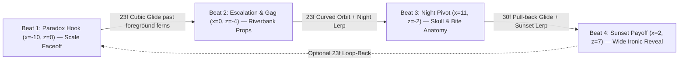

# 2D-in-3D TikTok Animation Production Guide

A practical, repo-ready blueprint for building high-retention **2D-in-3D stylized explainer animations** (9:16 vertical format) using **Three.js** and **Remotion**, modeled after the Mr omi production workflow—and tailored to integrate directly with the `dino-series` asset library (`svg/`, `svg/scenery/`, and `3d/`).

---

## Overview: What Makes This Style Work

This pipeline combines two core pillars:
1. **Visuals:** Flat, expressive 2D comic illustrations placed inside a real, lit 3D Three.js world—wrapped in a custom **Ink-Outline-Before-DoF** post-processing shader with lifted blacks and continuous gliding camera movement.
2. **Storytelling:** A **Paradox-to-Payoff** script with natural pauses (about 2.5–3 words per second, 60–75 s), where the 3D world's lighting shifts dynamically on the story's pivot beat.



---

## 1. Tech Stack & Recommended Repo Structure

* **3D Engine:** `three` + `@react-three/fiber` (WebGL scene, directional/rim lighting, alpha-tested shadow maps, custom shaders)
* **Video Renderer:** `remotion` + `@remotion/three` + `@remotion/media-utils` (deterministic frame-by-frame MP4 rendering at `1080×1920`, 30fps or 60fps)
* **2D Assets:** Transparent high-DPI PNG sprite states (exported from `dino-series` rigged SVGs or hand-drawn) + procedural HTML5 Canvas painterly textures
* **Audio & Timing:** Tightly edited VO track + ambient tension bed + punchy Foley SFX + word-level transcript JSON for frame-accurate beat syncing

### Core Dependencies

```json
{
  "dependencies": {
    "react": "^18.3.1",
    "react-dom": "^18.3.1",
    "remotion": "^4.0.0",
    "@remotion/cli": "^4.0.0",
    "@remotion/three": "^4.0.0",
    "@remotion/media-utils": "^4.0.0",
    "@react-three/fiber": "^8.17.0",
    "three": "^0.169.0"
  },
  "devDependencies": {
    "@types/three": "^0.169.0",
    "typescript": "^5.6.0"
  }
}
```

### Recommended Directory Layout

```text
project-root/
├── public/
│   ├── audio/
│   │   ├── voiceover.mp3          # Long gaps trimmed, natural pauses kept (~2.5–3 words/sec)
│   │   ├── transcript.json        # Word-level start/end timestamps (Whisper / Gentle)
│   │   ├── bed-tension.mp3        # Subtle low-end drone/ambient bed (-24 dB)
│   │   └── sfx/                   # Bone crunch, water splash, whooshes, camera swish
│   ├── fonts/
│   │   ├── BigShouldersDisplay-ExtraBold.woff2
│   │   └── PublicSans-SemiBold.woff2
│   └── sprites/
│       ├── trex/                  # default.png, roaring.png, surprised.png, smug.png
│       └── spinosaurus/           # default.png, roaring.png, striking.png, surprised.png
├── src/
│   ├── scene/
│   │   ├── Environment.tsx        # 3D terrain, water plane, rocks, trees, ferns
│   │   ├── CutoutActor.tsx        # Lit 2D sprite plane + silhouette shadow depth material
│   │   ├── LightingRig.tsx        # Story-driven mood lerps (moods picked per episode)
│   │   └── ProceduralTextures.ts  # Offscreen HTML5 Canvas painterly rock/bark/ground maps
│   ├── shaders/
│   │   ├── InkOutlineShader.ts    # Pass 1: Sobel Depth/Luma edges + lifted blacks
│   │   ├── DepthOfFieldShader.ts  # Pass 2: Circular bokeh DoF (runs AFTER ink)
│   │   └── PostPipeline.tsx       # Offscreen RenderTarget + ordered two-pass composer
│   ├── choreography/
│   │   ├── cameraBeats.ts         # Continuous ease-in/out keyframes & slow push-ins
│   │   ├── episodeScript.ts       # Frame-locked beat timestamps, poses, and stat anchors
│   │   └── projectToScreen.ts     # 3D-to-2D anchor projection for comic stat callouts
│   ├── ui/
│   │   ├── CaptionsLayer.tsx      # Word-by-word kinetic subtitles inside safe zones
│   │   ├── StatBadge.tsx          # Projected comic callout cards with pop-in springs
│   │   └── SafeZoneGuide.tsx      # Toggleable TikTok UI overlay debugger
│   ├── EpisodeComposition.tsx     # Main 3D + 2D layered Remotion scene
│   └── Root.tsx                   # Remotion 1080x1920 composition registry
├── remotion.config.ts             # Headless WebGL (`angle`) & render performance config
└── ANIMATION_GUIDE.md
```

### Essential `remotion.config.ts` Settings (WebGL)

Headless Chrome needs hardware-emulated or ANGLE-backed WebGL enabled explicitly, or Three.js canvases will render blank or crawl on software SwiftShader:

```ts
import { Config } from '@remotion/cli/config';

Config.setVideoImageFormat('jpeg');
Config.setJpegQuality(92);
Config.setOverwriteOutput(true);
// 'angle' uses native GPU (Metal/D3D11/Vulkan); fall back to 'swangle' on GPU-less CI runners
Config.setChromiumOpenGlRenderer('angle');
// Keep concurrency modest for heavy WebGL shaders to prevent GPU context loss
Config.setConcurrency(4);
```

---

## 2. The Viral Script Formula & Audio Engineering

Before touching code, lock the script and voiceover. Every visual beat, sprite swap, camera move, and lighting shift is driven by exact VO frame numbers.

Series length is **60–75 s**; scale the beat timings below proportionally. The lighting column is one option: each episode picks its moods (section 5).

| Beat | Timing (60s) | Frames (30fps) | Purpose | Lighting Mood | Camera Energy |
| :--- | :--- | :--- | :--- | :--- | :--- |
| **1. Paradox Hook** | `0:00–0:05` | `0–150` | State a surprising contradiction that stops the scroll in the first 2 seconds. | Warm, bright **Daylight** | Immediate gentle push-in on hero cutout |
| **2. Escalation + Dry Gag** | `0:05–0:20` | `150–600` | Raise the stakes, drop scale/stats callouts, land one quick deadpan visual gag. | Warm **Daylight** | 23-frame curved glide to Beat 2 staging; stat badges pop |
| **3. The *"You see..."* Pivot** | `0:20–0:45` | `600–1350` | Shift from *what* happened to *why*. Dive into anatomy, physics, or paleobiology. | **Deep Night Blue** + warm rim lights | Dramatic orbit-push; tight close-ups on anatomical details |
| **4. Ironic Payoff** | `0:45–1:00` | `1350–1800` | Subvert the setup with a punchy, memorable closing image. End cleanly on the last word. | **Sunset Glow** + purple shadows | Slow pull-back or loop-back glide to opening composition |

### Worked Example: 60-Second Beat Sheet (*T. rex vs. Spinosaurus*)

| Frames (30fps) | Beat | Voiceover Line (238 words total ≈ 3.96 wps) | Visual / Sprite / SFX Action |
| :--- | :--- | :--- | :--- |
| `0–150` | **Paradox Hook** | *"Spinosaurus was longer than T. rex—14 meters nose to tail—so Hollywood made it the ultimate dino-killer. In real life, it would have lost that fight in ten seconds."* | Daylight Hell Creek bank. `spinosaurus/smug.png` towers next to `trex/default.png`; stat badge `14 m` vs `12 m` pops with paper-snap SFX. |
| `150–420` | **Escalation** | *"On paper, Spinosaurus looks broken: a crocodile snout, giant hooked thumb claws, and a 1.6-meter sail on its back..."* | 23f glide along Spinosaurus silhouette; camera pushes into skull, claws, and sail with crisp callout badges. |
| `420–600` | **Dry Gag** | *"...built like a prehistoric Swiss Army knife—if the knife was specifically designed for aggressive bass fishing."* | Hard-comic pose swap to `spinosaurus/striking.png` holding a tiny stunned fish (`water-splash.wav` + dry record-stop beat). |
| `600–1050` | ***"You see..."* Pivot** | *"You see, bite physics tells a completely different story. Spinosaurus had narrow, conical teeth built to pin slippery fish—not crush bone. T. rex? Its boxy skull packed 35,000 newtons of bone-shattering force..."* | **Lighting lerps over 36f → Night Blue** with hot `#ffad5c` rim light. Camera glides to `trex/roaring.png`; jaw crunch SFX 2 frames before jaw opens. |
| `1050–1350` | **Anatomy Proof** | *"...and its paddle-like tail meant Spinosaurus ruled the Bahariya riverbanks, not open-field brawls."* | Glide past foreground ferns to riverside staging; water UV scroll speeds up gently. |
| `1350–1800` | **Ironic Payoff** | *"Even better: they lived thirty million years and an ocean apart. So the only place this fight ever happens... is in movie trailers."* | **Lighting lerps over 40f → Sunset Glow**. Camera pulls back smoothly as both cutouts turn deadpan (`surprised.png` / `default.png`) toward the lens. |

### Audio & Pacing Rules

* **Length:** 60–75 s per episode (at least 60 s for monetised shorts; the cap keeps it tight).
* **Target Pace:** about 2.5–3 words per second at 1.0x tempo (roughly 160–210 words for 60–75 s). Do not speed the voice up; a rushed start was the main complaint on Ep01's earlier drafts.
* **Keep Natural Pauses:** keep pauses up to `0.5 s` (they carry the `...` and `<short pause>` beats) and cut longer gaps down to `0.3 s`. This replaces the earlier 150 ms "zero dead air" rule.
  ```bash
  npm run prep:voice -- --input episodes/<ep>/raw-vo.wav --script episodes/<ep>/voiceover.txt --max-pause 0.5 --keep-gap 0.3
  ```
* **Lead-in:** about 1 s of picture before the first word, so the opening is not rushed.
* **Mix Hierarchy (Target Integrated Loudness: `-14 LUFS`):**
  * **Voiceover:** `-14 LUFS` (high-pass at `80 Hz`, gentle 3:1 compression, `-1.5 dBTP` limiter).
  * **Foley / Punch SFX:** `-10 dB` to `-6 dB` peak, placed **1–2 frames ahead** of visual pose swaps or stat badge pops (human ears perceive audio as synced when it leads crisp animation by ~30–50ms).
  * **Ambient Tension Bed:** `-26 dB` to `-22 dB` (sidechain-ducked `-4 dB` underneath VO; if the episode has a lighting pivot, swap texture subtly there).
* **Auto-Generating Beat Timestamps:** Run Whisper with `--word_timestamps True` on the trimmed `voiceover.mp3` to produce `public/audio/transcript.json`. Use those exact word seconds (`Math.round(word.start * fps)`) to drive both captions and camera/pose cues—never eyeball timestamps manually.
* **Loopable Ending (Optional):** Write the final sentence so it flows grammatically into the opening hook (e.g., *"...which is the exact reason why—"* → *"Spinosaurus was longer than T. rex..."*) and glide the final 23 frames back to frame `0`'s exact camera transform.

---

## 3. Asset Pipeline: 2D Cutouts in a Lit 3D World

Flat 2D characters should never look like pasted-on stickers—they must catch the 3D scene's directional key light, pick up the hot rim light during the Night Blue pivot, and cast real silhouette shadows onto the 3D terrain.

### Silhouette-Accurate 2D Cutout Planes

Use `MeshStandardMaterial` with `alphaTest: 0.5` and attach a **`customDepthMaterial`** so Three.js's shadow map cuts out the exact character silhouette instead of casting a rectangular plane shadow:

```ts
import * as THREE from 'three';

export function createLitCutoutPlane(
  texture: THREE.Texture,
  width: number,
  height: number
) {
  texture.colorSpace = THREE.SRGBColorSpace;
  texture.anisotropy = 8;

  const material = new THREE.MeshStandardMaterial({
    map: texture,
    alphaTest: 0.5,
    side: THREE.DoubleSide,
    roughness: 0.72,
    metalness: 0.04,
  });

  const mesh = new THREE.Mesh(new THREE.PlaneGeometry(width, height), material);
  mesh.castShadow = true;
  mesh.receiveShadow = true;

  // CRITICAL: Makes directional shadows match the 2D alpha silhouette
  mesh.customDepthMaterial = new THREE.MeshDepthMaterial({
    depthPacking: THREE.RGBADepthPacking,
    map: texture,
    alphaTest: 0.5,
  });

  return mesh;
}
```

### Complete `CutoutActor.tsx` Component (With Cylindrical Facing & Micro-Life)

Full spherical billboarding makes 2D characters tilt backward awkwardly when the camera looks down from above. Instead, use **Y-axis-only (cylindrical) facing** or a fixed world angle with gentle squash-and-stretch breathing anchored at the character's feet (`y = 0` pivot):

```tsx
import React, { useMemo, useRef } from 'react';
import * as THREE from 'three';
import { useThree } from '@react-three/fiber';
import { useCurrentFrame, useVideoConfig } from 'remotion';

export type CutoutActorProps = {
  textures: Record<string, THREE.Texture>;
  activePose: string;
  position: [number, number, number];
  size: [number, number]; // [width, height] in world units (e.g. meters)
  faceCameraY?: boolean;
  flipX?: boolean;
  breathSpeed?: number;   // radians/sec
  breathAmp?: number;     // e.g. 0.018 (1.8% vertical stretch)
  phaseOffset?: number;   // desync multiple actors
};

export const CutoutActor: React.FC<CutoutActorProps> = ({
  textures,
  activePose,
  position,
  size,
  faceCameraY = true,
  flipX = false,
  breathSpeed = 2.4,
  breathAmp = 0.018,
  phaseOffset = 0,
}) => {
  const frame = useCurrentFrame();
  const { fps } = useVideoConfig();
  const { camera } = useThree();
  const groupRef = useRef<THREE.Group>(null);

  const elapsed = frame / fps;
  const activeTex = textures[activePose] ?? Object.values(textures)[0];

  // Configure texture once without mutating every frame
  useMemo(() => {
    Object.values(textures).forEach((tex) => {
      tex.colorSpace = THREE.SRGBColorSpace;
      tex.anisotropy = 8;
      tex.needsUpdate = true;
    });
  }, [textures]);

  const depthMaterial = useMemo(
    () =>
      new THREE.MeshDepthMaterial({
        depthPacking: THREE.RGBADepthPacking,
        map: activeTex,
        alphaTest: 0.5,
      }),
    [activeTex]
  );

  // Subtle deterministic breathing anchored at ground contact (feet at y = 0)
  const breath = Math.sin(elapsed * breathSpeed + phaseOffset);
  const scaleY = 1 + breath * breathAmp;
  const scaleX = (flipX ? -1 : 1) * (1 - breath * breathAmp * 0.45);

  // Optional cylindrical Y-only billboard toward camera
  let rotY = 0;
  if (faceCameraY) {
    rotY = Math.atan2(
      camera.position.x - position[0],
      camera.position.z - position[2]
    );
  }

  return (
    <group ref={groupRef} position={position} rotation={[0, rotY, 0]}>
      {/* Offset plane up by height/2 so scale.y pivots cleanly from the feet */}
      <mesh
        position={[0, (size[1] * scaleY) / 2, 0]}
        scale={[scaleX, scaleY, 1]}
        castShadow
        receiveShadow
        customDepthMaterial={depthMaterial}
      >
        <planeGeometry args={[size[0], size[1]]} />
        <meshStandardMaterial
          map={activeTex}
          alphaTest={0.5}
          side={THREE.DoubleSide}
          roughness={0.72}
          metalness={0.04}
        />
      </mesh>
    </group>
  );
};
```

### Integrating Existing `dino-series` Assets

This repository already contains six cel-shaded dinosaur rigs (`svg/*-animated.svg`), habitat plant/ground SVGs (`svg/scenery/`), and interactive Three.js models (`3d/*-3d.html`). You can turn them directly into 2D-in-3D actors:

1. **Export Multi-Pose PNG Sprites from `svg/*-animated.svg`:**
   * Strip the `<prefix>anim` class from the root `<svg>` to pause CSS loops, then rotate rigged groups (`#head`, `#jaw`, `#neck`, `#tail`, `#body`, `<prefix>eyelid`) via Playwright + headless Chrome and capture transparent PNGs at `2×` resolution (e.g., `1600px` wide) for `default.png`, `roaring.png`, `surprised.png`, and `striking.png`.
   * Keep `dinokit.py`'s signature outer outline (`#2A1C22`)—it harmonizes naturally with the lifted-indigo ink shader (`#1d1e30`–`#241833`) because it avoids pure `#000000`.
2. **Reuse Habitat Scenery (`svg/scenery/*.svg`) as Layered 3D Foliage Cards:**
   * Export `hell-creek-ferns.svg`, `hell-creek-fan-palm.svg`, `bahariya-weichselia-fern.svg`, and `morrison-cycad.svg` as alpha-tested cutout planes placed at staggered Z-depths (`z = -6`, `z = +2`, `z = +5`). When the camera glides past foreground ferns placed near the lens, the DoF pass melts them into lush comic parallax framing.
3. **Optional Hybrid 3D Props:**
   * Use simple 3D terrain meshes, low-poly sculpted cliffs/boulders, and water planes—or import hero props from `3d/*-3d.html`—so shadows, occlusion, and depth-based Sobel outlines wrap authentically around the 2D cutouts.

### Fast Asset Reuse & Painterly 3D Props

* **Swappable Expressions/Poses:** Preload 3–5 sprite states per character (`default`, `roaring`, `surprised`, `smug`) and swap `activePose` on exact VO cue frames. Add a 3-frame `1.06×` squash-and-stretch overshoot pop on pose swaps so switches feel animated rather than static.
* **Procedural Painterly Textures (Offscreen HTML5 Canvas):** Never leave 3D rocks, tree trunks, or ground planes with flat solid colors. Generate deterministic painterly Canvas textures at startup (seeded—no `Math.random()`) with layered brush dabs, moss patches, and subtle charcoal ink cracks:

```ts
import * as THREE from 'three';

function mulberry32(seed: number) {
  return () => {
    let t = (seed += 0x6d2b79f5);
    t = Math.imul(t ^ (t >>> 15), t | 1);
    t ^= t + Math.imul(t ^ (t >>> 7), t | 61);
    return ((t ^ (t >>> 14)) >>> 0) / 4294967296;
  };
}

export function createPainterlyRockTexture(seed = 42, baseHex = '#8c7e74') {
  const size = 512;
  const canvas = document.createElement('canvas');
  canvas.width = size;
  canvas.height = size;
  const ctx = canvas.getContext('2d')!;
  const rand = mulberry32(seed);

  ctx.fillStyle = baseHex;
  ctx.fillRect(0, 0, size, size);

  // Layered painterly brush dabs
  const tones = ['#7a6d64', '#9e8f82', '#6a7459', '#b2a392'];
  for (let i = 0; i < 420; i++) {
    ctx.fillStyle = tones[Math.floor(rand() * tones.length)];
    ctx.globalAlpha = 0.18 + rand() * 0.22;
    ctx.beginPath();
    ctx.ellipse(
      rand() * size,
      rand() * size,
      10 + rand() * 34,
      5 + rand() * 14,
      rand() * Math.PI,
      0,
      Math.PI * 2
    );
    ctx.fill();
  }

  // Subtle lifted-charcoal comic ink cracks (never pure #000000)
  ctx.globalAlpha = 0.45;
  ctx.strokeStyle = '#1d1e30';
  ctx.lineWidth = 2.2;
  for (let i = 0; i < 28; i++) {
    let x = rand() * size;
    let y = rand() * size;
    ctx.beginPath();
    ctx.moveTo(x, y);
    for (let s = 0; s < 4; s++) {
      x += (rand() - 0.5) * 44;
      y += (rand() - 0.5) * 28;
      ctx.lineTo(x, y);
    }
    ctx.stroke();
  }

  const tex = new THREE.CanvasTexture(canvas);
  tex.wrapS = tex.wrapT = THREE.RepeatWrapping;
  tex.colorSpace = THREE.SRGBColorSpace;
  return tex;
}
```

* **Micro-Life (Zero Frozen Frames):**
  * **Actor breathing:** `scale.y` sine wave (`±1.8%`) with inverse `scale.x` volume conservation.
  * **Foliage breeze:** Deterministic Z-rotation sway (`Math.sin(elapsed * 1.9 + worldX * 0.7) * 0.045`).
  * **Water flow:** Scroll water diffuse/normal texture UVs (`waterTex.offset.x = (elapsed * 0.08) % 1`) and gently oscillate specular foam opacity.
  * **Ambient dust motes / fireflies:** 30–60 tiny instanced warm sprites drifting slowly along sine paths—especially effective during the Night Blue and Sunset beats.

---

## 4. Post-Processing Pipeline (Order Is Critical!)

The signature comic-book look depends on **strict pass ordering**.

> **CRITICAL RULE:** Always run the **Comic Ink Outline Pass *before* the Depth-of-Field (DoF) Blur Pass**.  
> If you blur first—or try to merge both into a single pass—the DoF blur smears depth/color gradients and wipes out your ink outlines.



### Render Target Setup

Both passes share the exact same **sharp `DepthTexture`** from the initial scene render:

```ts
import * as THREE from 'three';

export function createSceneRenderTarget(width: number, height: number) {
  const depthTexture = new THREE.DepthTexture(width, height);
  depthTexture.type = THREE.UnsignedIntType;

  return new THREE.WebGLRenderTarget(width, height, {
    minFilter: THREE.LinearFilter,
    magFilter: THREE.LinearFilter,
    format: THREE.RGBAFormat,
    type: THREE.HalfFloatType, // prevents banding before color grading
    depthBuffer: true,
    depthTexture,
  });
}
```

### Pass 1 — `InkOutlineShader.ts` (Sobel Depth + Luma + Lifted Blacks)

Runs a 3×3 Sobel edge detector on **linearized depth** (crisp 3D silhouettes around terrain, rocks, and 2D cutout edges) plus a light Sobel pass on **luminance** (internal texture lines), fades distant outlines into the fog, boosts saturation (~1.15×), and clamps darks to a lifted indigo-charcoal floor so **pure `#000000` never appears anywhere**:

```ts
import * as THREE from 'three';

export const InkOutlineShader = {
  uniforms: {
    tDiffuse: { value: null as THREE.Texture | null },
    tDepth: { value: null as THREE.Texture | null },
    uResolution: { value: new THREE.Vector2(1080, 1920) },
    uCameraNear: { value: 0.1 },
    uCameraFar: { value: 120.0 },
    uInkColor: { value: new THREE.Color('#1d1e30') },
    uBlackLift: { value: new THREE.Vector3(0.075, 0.082, 0.135) }, // ~#1c1d30 lifted floor
    uDepthThreshold: { value: 0.012 },
    uLumaThreshold: { value: 0.22 },
    uEdgeFadeStart: { value: 24.0 },
    uEdgeFadeEnd: { value: 68.0 },
    uSaturation: { value: 1.15 },
    uLineThickness: { value: 1.15 },
  },

  vertexShader: /* glsl */ `
    varying vec2 vUv;
    void main() {
      vUv = uv;
      gl_Position = projectionMatrix * modelViewMatrix * vec4(position, 1.0);
    }
  `,

  fragmentShader: /* glsl */ `
    #include <packing>

    uniform sampler2D tDiffuse;
    uniform sampler2D tDepth;
    uniform vec2 uResolution;
    uniform float uCameraNear;
    uniform float uCameraFar;
    uniform vec3 uInkColor;
    uniform vec3 uBlackLift;
    uniform float uDepthThreshold;
    uniform float uLumaThreshold;
    uniform float uEdgeFadeStart;
    uniform float uEdgeFadeEnd;
    uniform float uSaturation;
    uniform float uLineThickness;

    varying vec2 vUv;

    float getViewDist(vec2 uv) {
      float fragCoordZ = texture2D(tDepth, uv).x;
      float viewZ = perspectiveDepthToViewZ(fragCoordZ, uCameraNear, uCameraFar);
      return -viewZ;
    }

    float getLuma(vec2 uv) {
      vec3 c = texture2D(tDiffuse, uv).rgb;
      return dot(c, vec3(0.299, 0.587, 0.114));
    }

    vec3 adjustSaturation(vec3 color, float sat) {
      float gray = dot(color, vec3(0.299, 0.587, 0.114));
      return mix(vec3(gray), color, sat);
    }

    void main() {
      vec2 texel = (1.0 / uResolution) * uLineThickness;
      vec4 base = texture2D(tDiffuse, vUv);
      float centerDist = getViewDist(vUv);

      // 3x3 Sobel on normalized linear depth (robust across near & mid distances)
      float dTL = getViewDist(vUv + texel * vec2(-1.0,  1.0)) / centerDist;
      float dTC = getViewDist(vUv + texel * vec2( 0.0,  1.0)) / centerDist;
      float dTR = getViewDist(vUv + texel * vec2( 1.0,  1.0)) / centerDist;
      float dML = getViewDist(vUv + texel * vec2(-1.0,  0.0)) / centerDist;
      float dMR = getViewDist(vUv + texel * vec2( 1.0,  0.0)) / centerDist;
      float dBL = getViewDist(vUv + texel * vec2(-1.0, -1.0)) / centerDist;
      float dBC = getViewDist(vUv + texel * vec2( 0.0, -1.0)) / centerDist;
      float dBR = getViewDist(vUv + texel * vec2( 1.0, -1.0)) / centerDist;

      float gxD = -dTL - 2.0 * dML - dBL + dTR + 2.0 * dMR + dBR;
      float gyD = -dTL - 2.0 * dTC - dTR + dBL + 2.0 * dBC + dBR;
      float depthEdge = smoothstep(uDepthThreshold, uDepthThreshold * 2.5, length(vec2(gxD, gyD)));

      // Light 3x3 Sobel on luminance for subtle interior texture lines
      float lTL = getLuma(vUv + texel * vec2(-1.0,  1.0));
      float lTC = getLuma(vUv + texel * vec2( 0.0,  1.0));
      float lTR = getLuma(vUv + texel * vec2( 1.0,  1.0));
      float lML = getLuma(vUv + texel * vec2(-1.0,  0.0));
      float lMR = getLuma(vUv + texel * vec2( 1.0,  0.0));
      float lBL = getLuma(vUv + texel * vec2(-1.0, -1.0));
      float lBC = getLuma(vUv + texel * vec2( 0.0, -1.0));
      float lBR = getLuma(vUv + texel * vec2( 1.0, -1.0));

      float gxL = -lTL - 2.0 * lML - lBL + lTR + 2.0 * lMR + lBR;
      float gyL = -lTL - 2.0 * lTC - lTR + lBL + 2.0 * lBC + lBR;
      float lumaEdge = smoothstep(uLumaThreshold, uLumaThreshold * 2.2, length(vec2(gxL, gyL))) * 0.42;

      // Fade outlines smoothly in the distance so horizons stay atmospheric
      float distFade = 1.0 - smoothstep(uEdgeFadeStart, uEdgeFadeEnd, centerDist);
      float inkMask = clamp(max(depthEdge, lumaEdge) * distFade, 0.0, 0.92);

      // Color grade: boost saturation + lift blacks so pure #000000 never appears
      vec3 graded = adjustSaturation(base.rgb, uSaturation);
      graded = max(graded, uBlackLift);
      graded = mix(graded, max(uInkColor, uBlackLift), inkMask);

      gl_FragColor = vec4(graded, base.a);
    }
  `,
};
```

### Pass 2 — `DepthOfFieldShader.ts` (Circular Bokeh Blur)

Reads the **already-inked** texture from Pass 1 alongside the original sharp `tDepth` texture. Dynamically tracks `uFocusDist = camera.position.distanceTo(cameraTarget)` so 2D actors stay razor-sharp while foreground ferns and distant 3D cliffs melt into soft circular bokeh:

```ts
import * as THREE from 'three';

export const DepthOfFieldShader = {
  uniforms: {
    tDiffuse: { value: null as THREE.Texture | null }, // Output of Pass 1 (Inked!)
    tDepth: { value: null as THREE.Texture | null },   // Original sharp DepthTexture
    uResolution: { value: new THREE.Vector2(1080, 1920) },
    uCameraNear: { value: 0.1 },
    uCameraFar: { value: 120.0 },
    uFocusDist: { value: 12.0 },
    uFocusRange: { value: 5.5 },  // Sharp zone width around focus plane
    uMaxBlur: { value: 7.5 },     // Max bokeh radius in pixels at 1080p
  },

  vertexShader: /* glsl */ `
    varying vec2 vUv;
    void main() {
      vUv = uv;
      gl_Position = projectionMatrix * modelViewMatrix * vec4(position, 1.0);
    }
  `,

  fragmentShader: /* glsl */ `
    #include <packing>

    uniform sampler2D tDiffuse;
    uniform sampler2D tDepth;
    uniform vec2 uResolution;
    uniform float uCameraNear;
    uniform float uCameraFar;
    uniform float uFocusDist;
    uniform float uFocusRange;
    uniform float uMaxBlur;

    varying vec2 vUv;

    float getViewDist(vec2 uv) {
      float z = texture2D(tDepth, uv).x;
      return -perspectiveDepthToViewZ(z, uCameraNear, uCameraFar);
    }

    float getCoC(float dist) {
      float delta = abs(dist - uFocusDist);
      return smoothstep(uFocusRange * 0.35, uFocusRange * 1.8, delta);
    }

    void main() {
      float centerDist = getViewDist(vUv);
      float centerCoC = getCoC(centerDist);

      // Fast path for sharp in-focus pixels
      if (centerCoC < 0.02) {
        gl_FragColor = texture2D(tDiffuse, vUv);
        return;
      }

      vec2 texel = 1.0 / uResolution;
      vec3 acc = texture2D(tDiffuse, vUv).rgb;
      float totalWeight = 1.0;

      // Golden-angle circular disc sampling (24 taps = clean circular bokeh)
      const int TAPS = 24;
      const float GOLDEN_ANGLE = 2.39996323;

      for (int i = 1; i <= TAPS; i++) {
        float fi = float(i);
        float r = sqrt(fi / float(TAPS)) * uMaxBlur * centerCoC;
        float theta = fi * GOLDEN_ANGLE;
        vec2 offset = vec2(cos(theta), sin(theta)) * r * texel;
        vec2 sampleUv = clamp(vUv + offset, vec2(0.001), vec2(0.999));

        float sampleDist = getViewDist(sampleUv);
        float sampleCoC = getCoC(sampleDist);

        // Prevent sharp foreground cutouts from bleeding onto blurred backgrounds
        float weight = (sampleDist < centerDist - 0.5) ? sampleCoC : 1.0;
        acc += texture2D(tDiffuse, sampleUv).rgb * weight;
        totalWeight += weight;
      }

      gl_FragColor = vec4(acc / totalWeight, 1.0);
    }
  `,
};
```

### Post-Processing Debugging Quick Reference

| Symptom | Root Cause | Fix |
| :--- | :--- | :--- |
| Ink outlines disappear in blurred areas or look smeared | DoF ran before Ink, or both were combined in one pass | Render Scene → Pass 1 (`InkOutlineShader`) → RT2 → Pass 2 (`DepthOfFieldShader`) |
| Thick black halos around distant hills/trees | Depth Sobel wasn't divided by `centerDist` or `uEdgeFadeEnd` is too far | Normalize Sobel depth by `centerDist` and tune `uEdgeFadeStart`/`End` to match scene fog |
| Harsh pure `#000000` shadows crushing detail | Missing black-lift floor or `toneMapping` clamping darks after Pass 1 | Apply `max(graded, uBlackLift)` in Pass 1 and disable double-tonemapping on final blit |
| Foreground 2D cutout bleeds into blurred background | DoF kernel didn't reject closer sharp samples | Keep the `sampleDist < centerDist - 0.5 ? sampleCoC : 1.0` depth-aware tap weighting |

---

## 5. Story-Driven Lighting Shifts

**Moods are picked per episode** to fit the story: night and sunset are options, not a required arc. Ep01 uses daylight warming to late afternoon (`lateAfternoon` in `src/video/scene/LightingRig.tsx`); the repo's rig currently holds only `daylight` and `lateAfternoon`, so an episode that needs night or sunset adds those moods back from the table below.

Instead of static lighting, smoothly interpolate (`lerp`) your sky dome gradient, exponential fog, directional key light, hemisphere shadow color, rim light, and shader ink color between story beats.

| Mood | Story Beat | Key Light | Shadow / Hemi Ground | Rim Light | Sky Top → Horizon | Fog (`FogExp2`) | Ink Color |
| :--- | :--- | :--- | :--- | :--- | :--- | :--- | :--- |
| **Daylight** | Hook + Escalation | Warm Sun `#ffe2a8` (`2.15`) | Cool Blue `#475c96` (`0.95`) | Soft Gold `#ffd394` (`0.65`) | `#5ea8e6` → `#f5dfb8` | `#d8e5ea` (`0.011`) | `#1d1e30` |
| **Night Blue** | *"You see..."* Pivot | Cool Moon `#6db4ff` (`1.25`) | Deep Navy `#1d274d` (`0.70`) | **Strong Warm Orange `#ffad5c` (`1.95`)** | `#0f1733` → `#1e335c` | `#162344` (`0.018`) | `#121629` |
| **Sunset** | Ironic Payoff | Warm Coral `#ff9d5c` (`2.25`) | **Deep Purple `#4c2d6e` (`0.85`)** | Golden `#ffcf75` (`1.35`) | `#3b2563` → `#ff9b6a` | `#6e446b` (`0.014`) | `#241833` |

### Why These Three Palettes Work
* **Daylight → Night Blue Pivot:** Instantly signals *"pay attention—we're entering the explanation."* The **hot orange rim light (`#ffad5c` at `1.95`)** carves the flat 2D cutouts right off the dark navy background so silhouettes stay readable on small phone screens.
* **Night Blue → Sunset Payoff:** Swapping cool shadows to **deep purple (`#4c2d6e`)** paired with warm coral key light creates a cinematic "wrap-up" emotional release without ever dipping into muddy brown or pure black.

### `LightingRig.tsx` Implementation

```ts
import * as THREE from 'three';
import { Easing, interpolate } from 'remotion';

export type LightingMood = {
  keyColor: string;
  keyIntensity: number;
  hemiSky: string;
  hemiGround: string;
  hemiIntensity: number;
  rimColor: string;
  rimIntensity: number;
  fogColor: string;
  fogDensity: number;
  inkColor: string;
};

export const LIGHTING_MOODS: Record<'daylight' | 'nightBlue' | 'sunset', LightingMood> = {
  daylight: {
    keyColor: '#ffe2a8',
    keyIntensity: 2.15,
    hemiSky: '#a8d5ff',
    hemiGround: '#475c96',
    hemiIntensity: 0.95,
    rimColor: '#ffd394',
    rimIntensity: 0.65,
    fogColor: '#d8e5ea',
    fogDensity: 0.011,
    inkColor: '#1d1e30',
  },
  nightBlue: {
    keyColor: '#6db4ff',
    keyIntensity: 1.25,
    hemiSky: '#2d4c85',
    hemiGround: '#1d274d',
    hemiIntensity: 0.70,
    rimColor: '#ffad5c',
    rimIntensity: 1.95,
    fogColor: '#162344',
    fogDensity: 0.018,
    inkColor: '#121629',
  },
  sunset: {
    keyColor: '#ff9d5c',
    keyIntensity: 2.25,
    hemiSky: '#ff9b6a',
    hemiGround: '#4c2d6e',
    hemiIntensity: 0.85,
    rimColor: '#ffcf75',
    rimIntensity: 1.35,
    fogColor: '#6e446b',
    fogDensity: 0.014,
    inkColor: '#241833',
  },
};

const _cA = new THREE.Color();
const _cB = new THREE.Color();

export function lerpColorHex(hexA: string, hexB: string, t: number, out = new THREE.Color()) {
  return out.copy(_cA.set(hexA)).lerp(_cB.set(hexB), t);
}

/**
 * Computes smoothly blended lighting state for any Remotion frame.
 * Example pivot frames (30fps): Night transition 582..618, Sunset transition 1330..1370.
 */
export function evaluateLightingAtFrame(
  frame: number,
  nightTransition: [number, number] = [582, 618],
  sunsetTransition: [number, number] = [1330, 1370]
) {
  const tNight = interpolate(frame, nightTransition, [0, 1], {
    extrapolateLeft: 'clamp',
    extrapolateRight: 'clamp',
    easing: Easing.inOut(Easing.cubic),
  });
  const tSunset = interpolate(frame, sunsetTransition, [0, 1], {
    extrapolateLeft: 'clamp',
    extrapolateRight: 'clamp',
    easing: Easing.inOut(Easing.cubic),
  });

  const from = tSunset > 0 ? LIGHTING_MOODS.nightBlue : LIGHTING_MOODS.daylight;
  const to = tSunset > 0 ? LIGHTING_MOODS.sunset : LIGHTING_MOODS.nightBlue;
  const t = tSunset > 0 ? tSunset : tNight;

  return {
    keyColor: lerpColorHex(from.keyColor, to.keyColor, t),
    keyIntensity: THREE.MathUtils.lerp(from.keyIntensity, to.keyIntensity, t),
    hemiSky: lerpColorHex(from.hemiSky, to.hemiSky, t),
    hemiGround: lerpColorHex(from.hemiGround, to.hemiGround, t),
    hemiIntensity: THREE.MathUtils.lerp(from.hemiIntensity, to.hemiIntensity, t),
    rimColor: lerpColorHex(from.rimColor, to.rimColor, t),
    rimIntensity: THREE.MathUtils.lerp(from.rimIntensity, to.rimIntensity, t),
    fogColor: lerpColorHex(from.fogColor, to.fogColor, t),
    fogDensity: THREE.MathUtils.lerp(from.fogDensity, to.fogDensity, t),
    inkColor: lerpColorHex(from.inkColor, to.inkColor, t),
  };
}
```

---

## 6. Camera Choreography (Glides, Few Cuts)

Prefer gliding moves: arrange story beats as physical stations inside one contiguous 3D environment so the camera glides past rocks, trees, and foreground foliage from beat to beat. Cut only when changing location. Whatever the move, every line needs its speaker or the thing it names at the focal point, and every claim needs a visual (if the line says bite marks, show the bite marks).

### Spatial Staging Map (Top-Down 3D World)



### Core Motion Rules

* **Smooth Transitions:** Use cubic or quintic **ease-in / ease-out curves over ~23 frames** (~0.75s at 30fps; ~46 frames at 60fps) when swinging between staging areas.
* **Constant Momentum:** Keep a subtle **slow push-in** (`+0.35` to `+0.75` world units along the view vector) running on roughly **65% of all frames** while a character talks or stats appear. Static locked cameras drop vertical-video retention immediately.
* **Subtle Handheld Micro-Drift:** Add a tiny low-frequency deterministic sine sway (`±0.04` units Y, `±0.03` units X) so the lens feels alive like a floating cinema rig.
* **Dynamic DoF Focus Tracking:** Update `DepthOfFieldShader.uniforms.uFocusDist.value = camera.position.distanceTo(currentTarget)` every frame so focus glides naturally with the camera.

### `cameraBeats.ts` — Declarative Camera Keyframe Engine

```ts
import * as THREE from 'three';
import { Easing, interpolate } from 'remotion';

export type CameraBeat = {
  startFrame: number;
  endFrame: number;
  fromPos: [number, number, number];
  toPos: [number, number, number];
  fromTarget: [number, number, number];
  toTarget: [number, number, number];
  fov?: number;
  easing?: (t: number) => number;
};

export const EPISODE_CAMERA_BEATS: CameraBeat[] = [
  // Beat 1: Slow push-in on Paradox Hook
  {
    startFrame: 0,
    endFrame: 127,
    fromPos: [-10, 3.2, 13.5],
    toPos: [-10, 3.1, 11.4],
    fromTarget: [-10, 2.6, 0],
    toTarget: [-10, 2.7, 0],
    fov: 36,
    easing: Easing.linear,
  },
  // 23-frame smooth transition glide from Beat 1 -> Beat 2
  {
    startFrame: 127,
    endFrame: 150,
    fromPos: [-10, 3.1, 11.4],
    toPos: [0, 3.4, 9.5],
    fromTarget: [-10, 2.7, 0],
    toTarget: [0, 2.5, -4],
    fov: 36,
    easing: Easing.inOut(Easing.cubic),
  },
  // Beat 2: Slow push-in during Escalation & Gag
  {
    startFrame: 150,
    endFrame: 577,
    fromPos: [0, 3.4, 9.5],
    toPos: [0.4, 3.1, 7.6],
    fromTarget: [0, 2.5, -4],
    toTarget: [0.2, 2.5, -4],
    fov: 34,
    easing: Easing.linear,
  },
  // 23-frame pivot swing to Night Blue Anatomy Beat
  {
    startFrame: 577,
    endFrame: 600,
    fromPos: [0.4, 3.1, 7.6],
    toPos: [11, 3.6, 7.8],
    fromTarget: [0.2, 2.5, -4],
    toTarget: [11, 3.1, -2],
    fov: 32,
    easing: Easing.inOut(Easing.poly(4)),
  },
];

export function evaluateCameraAtFrame(frame: number, fps: number) {
  const beat =
    EPISODE_CAMERA_BEATS.find((b) => frame >= b.startFrame && frame <= b.endFrame) ??
    EPISODE_CAMERA_BEATS[EPISODE_CAMERA_BEATS.length - 1];

  const t = interpolate(frame, [beat.startFrame, beat.endFrame], [0, 1], {
    extrapolateLeft: 'clamp',
    extrapolateRight: 'clamp',
    easing: beat.easing ?? Easing.inOut(Easing.cubic),
  });

  const elapsed = frame / fps;
  const swayX = Math.sin(elapsed * 0.9) * 0.035;
  const swayY = Math.cos(elapsed * 0.65) * 0.04;

  const position = new THREE.Vector3(...beat.fromPos).lerp(
    new THREE.Vector3(...beat.toPos),
    t
  );
  position.x += swayX;
  position.y += swayY;

  const target = new THREE.Vector3(...beat.fromTarget).lerp(
    new THREE.Vector3(...beat.toTarget),
    t
  );

  return {
    position,
    target,
    fov: beat.fov ?? 36,
    focusDist: position.distanceTo(target),
  };
}
```

### 3D-to-2D Projected Stat Callouts

Project 3D anchor points (`anchor.project(camera)`) into 2D screen pixel coordinates so floating comic stat badges stay pinned to characters as the camera glides—while staying clamped inside TikTok's safe zone:

```ts
import * as THREE from 'three';

export function projectWorldToScreen(
  worldPos: THREE.Vector3,
  camera: THREE.Camera,
  width = 1080,
  height = 1920
) {
  const projected = worldPos.clone().project(camera);
  const isVisible = projected.z < 1; // in front of camera far plane

  const x = (projected.x * 0.5 + 0.5) * width;
  const y = (-projected.y * 0.5 + 0.5) * height;

  // Optional clamp to keep comic callouts out of TikTok UI danger zones
  return {
    x: THREE.MathUtils.clamp(x, 72, 840),
    y: THREE.MathUtils.clamp(y, 240, 1480),
    isVisible,
  };
}
```

---

## 7. Moving from Interactive Preview to Remotion Export

When porting a Three.js prototype into **Remotion** for final `1080×1920` MP4 rendering, every single frame must be a **pure function of `frame`**.

### Determinism Rules

1. **Zero Wall-Clock Timers:** Remove `requestAnimationFrame`, `THREE.Clock`, `Date.now()`, and damped `OrbitControls`. Compute time exclusively from `useCurrentFrame()` and `useVideoConfig()`:
   ```ts
   const frame = useCurrentFrame();
   const { fps, width, height } = useVideoConfig();
   const elapsed = frame / fps;
   ```
2. **Zero Unseeded Randomness:** Never call `Math.random()` inside geometry builders, particle loops, or React render. Use Remotion's deterministic `random('seed-name')` or a seeded PRNG (`mulberry32`) so parallel worker threads render identical frames.
3. **Gate Async Assets with `delayRender`:** Textures, fonts, and JSON transcripts must finish loading before Remotion captures frame `0`:
   ```ts
   const [handle] = useState(() => delayRender('Loading sprites & fonts'));
   useEffect(() => {
     Promise.all([loadSprites(), document.fonts.ready]).then(() =>
       continueRender(handle)
     );
   }, [handle]);
   ```
4. **Drive All Beats by Frame Number:** Map every pose swap, lighting shift, badge pop, and camera glide using Remotion's `interpolate()` and `spring()` synced to `transcript.json`.

### Remotion `Root.tsx` Registration

```tsx
import React from 'react';
import { Composition } from 'remotion';
import { EpisodeComposition } from './EpisodeComposition';

export const RemotionRoot: React.FC = () => {
  return (
    <Composition
      id="DinoExplainerVertical"
      component={EpisodeComposition}
      durationInFrames={1800} // 60s @ 30fps (series target: 60–75 s)
      fps={30}
      width={1080}
      height={1920}
      defaultProps={{
        showSafeZones: false,
      }}
    />
  );
};
```

### TikTok 9:16 Safe Zones (`1080×1920` Exact Pixel Map)

Keep all titles, projected stat badges, character faces, and captions strictly inside the safe center zone so TikTok's native HUD never covers your jokes or numbers:

```text
 0px ┌──────────────────────────────────────────┐ 1080px
     │          TOP DANGER ZONE (11%)           │  0–211px   (Following / For You / Search)
211px├──────────────────────────────────────────┤
     │                                          │
     │           SAFE CONTENT ZONE              │  x: 48–860px
     │     (Characters, Titles, Stat Badges)    │  y: 230–1520px
     │                                          │
806px│                                 ┌────────┤
     │                                 │ RIGHT  │  886–1080px (18% width)
     │        IDEAL CAPTION BAND       │ DANGER │  y: 806–1555px (42%–81% height)
     │         (y: 1180–1440px)        │  ZONE  │  (Avatar, Like, Comment, Share)
1555px├────────────────────────────────┴────────┤
     │         BOTTOM DANGER ZONE (19%)         │  1555–1920px (Handle, Caption, Audio)
1920px└─────────────────────────────────────────┘
```

#### Quick Toggleable `SafeZoneGuide.tsx` Overlay

Drop this over `<ThreeCanvas>` during preview (`showSafeZones={true}`) and toggle it off before final export:

```tsx
import React from 'react';
import { AbsoluteFill } from 'remotion';

export const SafeZoneGuide: React.FC<{ visible?: boolean }> = ({ visible }) => {
  if (!visible) return null;
  const danger = 'rgba(255, 59, 92, 0.28)';
  return (
    <AbsoluteFill style={{ pointerEvents: 'none', zIndex: 99 }}>
      {/* Top 11% */}
      <div style={{ position: 'absolute', top: 0, left: 0, right: 0, height: '11%', background: danger }} />
      {/* Right 18% from 42% to 81% */}
      <div style={{ position: 'absolute', top: '42%', right: 0, width: '18%', height: '39%', background: danger }} />
      {/* Bottom 19% */}
      <div style={{ position: 'absolute', bottom: 0, left: 0, right: 0, height: '19%', background: danger }} />
    </AbsoluteFill>
  );
};
```

### Typography & Kinetic Captions Spec

Match the `dino-series` visual identity so Shorts/TikToks look native to the posters and boards:
* **Display Titles & Stat Numbers:** `Big Shoulders Display` (`800` ExtraBold), uppercase, tight `0.92` line height.
* **Body Captions:** `Public Sans` (`700` Bold), `64px–74px` font size, **2–4 words per chunk** centered at `y: 1260px` (`maxWidth: 780px`, shifted slightly left if needed to clear the right icon column).
* **Comic Stroke Treatment:** Warm off-white fill (`#FFF6E8`), active spoken word highlighted in warm gold (`#FFD369`) or coral (`#FF9D5C`), backed by a `10px` lifted-charcoal outer stroke (`#1d1e30`, `paint-order: stroke fill`) and a crisp hard-offset comic drop shadow (`0 6px 0 #1d1e30`).

### Render Commands (Draft vs. Final Master)

```bash
# 1. Interactive studio preview with live timeline scrubbing
npx remotion studio

# 2. Fast half-res draft check (540x960) to verify pacing, lighting & safe zones
npx remotion render DinoExplainerVertical out/draft.mp4 \
  --scale=0.5 --crf=23 --gl=angle

# 3. High-retention 1080x1920 master for TikTok / Reels / Shorts (H.264, yuv420p)
npx remotion render DinoExplainerVertical out/episode-master.mp4 \
  --codec=h264 --pixel-format=yuv420p --crf=17 --gl=angle \
  --props='{"showSafeZones":false}'
```

---

## 8. Performance, Troubleshooting & Quality Assurance

| Issue | Likely Cause | Fix |
| :--- | :--- | :--- |
| **Blank/white WebGL frames during `remotion render`** | Default headless Chrome lacks GPU acceleration or context was lost under high concurrency | Pass `--gl=angle` (or `--gl=swangle` on headless Linux CI) and lower `--concurrency=2..4` |
| **First 2–5 frames miss sprites or show fallback font** | Async `TextureLoader` or web fonts resolved after frame `0` captured | Wrap texture + `document.fonts.ready` inside Remotion's `delayRender` / `continueRender` |
| **Cutout planes cast rectangular box shadows** | Missing `customDepthMaterial` on the `Mesh` | Assign `new THREE.MeshDepthMaterial({ depthPacking: THREE.RGBADepthPacking, map, alphaTest: 0.5 })` and update its `map` whenever the sprite pose swaps |
| **Z-fighting / flickering between overlapping 2D foliage planes** | Multiple cutouts share the exact same Z coordinate | Stagger Z positions by at least `0.05` world units and keep `alphaTest: 0.5` instead of `transparent: true` |
| **Caption drift over a 60s video** | Variable-bitrate (VBR) MP3 audio seeking mismatch | Convert `voiceover.mp3` to constant-bitrate (CBR) MP3 or uncompressed `.wav` before importing into Remotion |
| **Flickering 1px ink lines during slow camera push-ins** | Sharp depth/luma Sobel transitions aliasing on sub-pixel movement | Keep `uLineThickness` around `1.15–1.35`, render offscreen target at `1×` exact output resolution (`1080×1920`), and use smoothstep ranges (`uDepthThreshold` → `2.5×`) rather than hard `step()` |

---

## 9. Episode Production Checklist

### Pre-Production & Audio
- [ ] **Script:** Written in **Paradox → Escalation + Gag → *"You see..."* Pivot → Ironic Payoff** format (~230–245 words for 60s).
- [ ] **Scientific Facts Verified:** Lengths, anatomy, and habitats checked against published sources (consistent with `dino-series` standards).
- [ ] **Voiceover Mastered:** Long gaps trimmed with natural pauses kept (`--max-pause 0.5 --keep-gap 0.3`), normalized to `-14 LUFS`, saved as CBR MP3/WAV, and word-level `transcript.json` generated.
- [ ] **SFX & Bed Spotted:** Ambient bed ducked `-24 dB`; Foley hits placed 1–2 frames ahead of visual impacts.

### Assets & 3D World
- [ ] **2D Sprites:** 3–5 pose/expression transparent PNGs per character with lifted-charcoal outlines (`#1d1e30` / `#2A1C22`) and `customDepthMaterial` silhouette shadows verified.
- [ ] **3D Staging:** Terrain, painterly props, scrolling water, and foreground foliage arranged along one continuous camera path (glides; cut only when changing location).
- [ ] **Micro-Life Active:** Deterministic breathing, foliage sway, water UV scroll, and dust motes running from `elapsed = frame / fps`.

### Shaders, Lighting & Camera
- [ ] **Post-Processing Order Verified:** `InkOutlineShader` (Pass 1) runs strictly *before* `DepthOfFieldShader` (Pass 2); focus distance tracks `camera.position.distanceTo(target)`.
- [ ] **No Pure Blacks:** Final color-picked darkest pixels sit at lifted indigo-charcoal (`~#1c1d30`), never `#000000`.
- [ ] **Lighting Shifts Synced:** Smooth Daylight → Night Blue (with hot `#ffad5c` rim light) → Sunset (with `#4c2d6e` purple shadows) lerps aligned to VO pivot frames.
- [ ] **Camera Momentum Checked:** ~23-frame cubic/quintic glides between beats and slow push-ins covering ~65% of runtime.

### UI, Safe Zones & Final Export
- [ ] **Safe Zones Audited:** Verified with `<SafeZoneGuide visible={true} />` that captions, titles, and projected 3D→2D stat callouts clear the Top `11%`, Right `18%` (`42%–81%`), and Bottom `19%` TikTok overlays.
- [ ] **Debug Overlays Off & Rendered:** `<SafeZoneGuide />` disabled; exported at `1080×1920` (9:16), 30fps or 60fps via `npx remotion render` and watched end-to-end on a phone screen with audio on.
