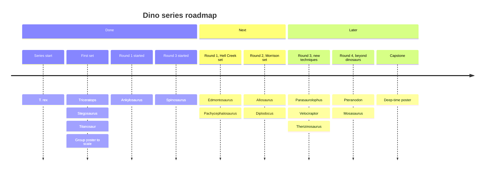

# dino-series

An illustrated dinosaur series in one shared style: cel-shaded vector drawings with dark outlines, stripes, a pale belly, gradient shading, scale texture and a warm rim light. Each dinosaur comes as an animated SVG, a GSAP page, a poster, a rig sheet and an interactive Three.js model.

- [The dinosaurs](#the-dinosaurs)
- [Project layout](#project-layout)
- [Using the drawings](#using-the-drawings)
- [Rebuilding](#rebuilding)
- [Scientific accuracy](#scientific-accuracy)
- [Design philosophy](#design-philosophy)
- [Roadmap](#roadmap)
- [Sources](#sources)

## The dinosaurs

| Species | Signature move | Animated SVG | GSAP page | 3D model |
|---|---|---|---|---|
| *Tyrannosaurus rex* | Roar | `svg/trex-animated.svg` | `gsap/trex-gsap.html` | `3d/trex-3d.html` |
| *Triceratops horridus* | Horns-down charge | `svg/triceratops-animated.svg` | `gsap/triceratops-gsap.html` | `3d/triceratops-3d.html` |
| *Stegosaurus stenops* | Spiked tail swing, plates flush red | `svg/stegosaurus-animated.svg` | `gsap/stegosaurus-gsap.html` | `3d/stegosaurus-3d.html` |
| *Patagotitan mayorum* (titanosaur) | Neck raise and call | `svg/titanosaur-animated.svg` | `gsap/titanosaur-gsap.html` | `3d/titanosaur-3d.html` |
| *Ankylosaurus magniventris* | Tail-club swing | `svg/ankylosaurus-animated.svg` | `gsap/ankylosaurus-gsap.html` | `3d/ankylosaurus-3d.html` |
| *Spinosaurus aegyptiacus* | Strike at a fish | `svg/spinosaurus-animated.svg` | `gsap/spinosaurus-gsap.html` | `3d/spinosaurus-3d.html` |

Each species also has a poster and a rig sheet in `boards/`, and `boards/Group.dc.html` shows all six together at their real lengths.

## Project layout

```text
dino-series/
├── svg/                       animated SVG, one per species; svg/scenery/ holds the scenery pieces and sets, svg/styles/ the ten style variants
├── gsap/                      GSAP page per species; click the dinosaur to play its move
├── 3d/                        Three.js model per species; drag to orbit, click to play the move
├── boards/                    posters and rig sheets (*.dc.html) and their canvas layout (canvas.json)
├── src/                       builders
│   ├── dinokit.py             shared toolkit: drawing helpers, motion CSS, poster and rig builders
│   ├── sp_*.py                one builder per species (Triceratops, Stegosaurus, titanosaur, Ankylosaurus, Spinosaurus)
│   ├── trex_drawing.py        the definitive T. rex drawing
│   ├── trex_svg.py            shading pass over it; writes svg/trex-animated.svg
│   ├── trex_gsap.py, trex_poster.py, trex_rig.py
│   ├── group_poster.py        every species to scale
│   ├── scenery.py             scenery kit: plants and ground by habitat, and the four poster backgrounds
│   ├── triceratops_3d.py      Triceratops 3D page, generated from the T. rex engine
│   ├── ankylosaurus_3d.py     Ankylosaurus 3D page, generated from the same engine
│   └── spinosaurus_3d.py      Spinosaurus 3D page, generated from the T. rex page
├── baseline/trex-boxy-head/   saved T. rex baseline: head shapes, ids and pivots
├── shots/                     local screenshots (not tracked)
├── CLAUDE.md                  project rules for Claude Code
└── README.md
```

## Using the drawings

Every moving part is its own group with an id. Each group sits inside a wrapper whose origin is the joint, so rotating or scaling with `transform-origin: 0 0` pivots in the right place. In GSAP, use `svgOrigin: "0 0"`.

| Species | Group ids | Class prefix |
|---|---|---|
| T. rex | `#tail` `#body` `#head` `#jaw` `#leg-near` `#leg-far` `#arm-near` `#arm-far` | `tr-` |
| Triceratops | `#act` `#body` `#tail` `#head` `#jaw` `#leg-near` `#leg-far` `#foreleg-near` `#foreleg-far` | `tri-` |
| Stegosaurus | `#act` `#body` `#plates` `#tail` `#head` `#leg-near` `#leg-far` `#foreleg-near` `#foreleg-far` | `stg-` |
| Titanosaur | `#act` `#body` `#tail` `#neck` `#head` `#jaw` `#leg-near` `#leg-far` `#foreleg-near` `#foreleg-far` | `tit-` |
| Ankylosaurus | `#act` `#body` `#tail` `#head` `#leg-near` `#leg-far` `#foreleg-near` `#foreleg-far` | `ank-` |
| Spinosaurus | `#act` `#body` `#tail` `#neck` `#head` `#jaw` `#leg-near` `#leg-far` `#arm-near` `#arm-far` | `spn-` |

- The standalone SVGs loop on their own. Remove the `<prefix>anim` class from the root `<svg>` to stop the built-in animation and drive the groups yourself.
- `#act` moves the whole animal, for example the Triceratops lunge.
- Each eyelid uses the class `<prefix>eyelid`.

## Rebuilding

Requires Python 3.11+ with `matplotlib`. The screenshot and browser checks also use Playwright and Google Chrome. Run the builders from anywhere; all paths are relative to the repository.

```sh
# T. rex
python3 src/trex_svg.py          # svg/trex-animated.svg, checked against baseline/trex-boxy-head/baseline.json
python3 src/trex_gsap.py         # gsap/trex-gsap.html
python3 src/trex_poster.py       # boards/Main.dc.html
python3 src/trex_rig.py          # boards/Rig.dc.html

# Other species: animated SVG, GSAP page, poster and rig sheet
python3 src/sp_triceratops.py
python3 src/sp_stegosaurus.py
python3 src/sp_titanosaur.py
python3 src/sp_ankylosaurus.py
python3 src/sp_spinosaurus.py

# Scenery kit: writes svg/scenery/ and boards/Scenery.dc.html (run before the posters)
python3 src/scenery.py

# Ten 2D design styles, each redrawn from the geometry with its own construction (blueprint, neon sign, pixel art,
# Ben-Day pop art, low-poly, woodcut, stained glass, stippled plate, crayon, Bauhaus); same rig and motion.
# Writes transparent svg/styles/<species>-<style>.svg, a preview page <species>-styles.html when all ten are built,
# and <style>.html (one style across species) when several species are given. Defaults: all styles, trex
python3 src/styles.py [style ...] [species ...]
python3 src/styles.py lowpoly trex triceratops stegosaurus titanosaur ankylosaurus spinosaurus

# Group poster to scale (measures each drawing in a browser)
python3 src/group_poster.py

# Triceratops 3D page, generated from the T. rex engine
python3 src/triceratops_3d.py

# Ankylosaurus 3D page, generated from the same engine
python3 src/ankylosaurus_3d.py

# Spinosaurus 3D page, generated from the T. rex page
python3 src/spinosaurus_3d.py
```

- `trex_drawing.py` is the definitive T. rex drawing. `trex_svg.py` layers the shading and texture pass over it without changing its shapes, ids or pivots, and stops if any of them change.
- Each animated SVG and its GSAP page carry the identical drawing, so rebuild them together.
- The 3D pages load Three.js 0.160 from jsdelivr and need no build step. When testing offline, serve the folder locally so the module imports resolve.

## Scientific accuracy

The drawings follow published anatomy for general shape and proportion. Skin colour is unknown for all of these animals and is an artistic choice.

| Species | What the drawing follows |
|---|---|
| Ankylosaurus | Short, keeled bony plates spaced apart in rows, with no large flank spikes; two half-rings of plates over the neck; short pyramid-shaped horns on the back corners and cheeks of the skull; nostrils on the side of the snout under a roofing scale; a low, flat tail club (about 60 cm long, 49 cm wide, 19 cm tall in AMNH 5214) on a stiff tail held off the ground. The club swung side to side, so the move shows the tail foreshortening as it swings away and whipping back |
| Stegosaurus | Proportions and plate shapes checked against mounted skeletons, chiefly *S. stenops* "Sophie" at the Natural History Museum: long, nearly straight hind legs and short, stout forelegs; broad, round-topped plates in two staggered rows, tallest over the hips and base of the tail, running down the tail and up the neck; four tail spikes pointing sideways and back rather than upright; bony studs on the throat; small, low head about a metre off the ground |
| Triceratops | Proportions checked against mounted skeletons (Houston's "Lane", Los Angeles, London and the Smithsonian's 3D-scanned "Hatcher") and 3D life restorations: a deep, barrel-shaped trunk, highest over the hips; long, columnar hind legs (4 hooves) and shorter semi-erect forelegs with elbows flexed back and slightly outward (3 inner hooves); a short, thick tail sloping down from the hips off the ground; a broad saddle-shaped frill swept up and back at ~45° over the neck with worn adult edge bones; a wedge-shaped skull about a third of body length, broad across the muscular jugal cheeks and narrowing to a deep compressed snout and hooked keratin beak; ~1 m brow horns diverging slightly outward and curving forward; pebbly skin with widely spaced cone-tipped feature scales, as in the Lane specimen |
| Titanosaur (*Patagotitan*) | Proportions follow published skeletal reconstructions and scale diagrams (used for general proportions, not traced): at 31 m long the back stands about 5 m high and the head about 12 m up, with a long neck raised at roughly 45 degrees, a deep, rounded torso, short pillar-like legs and a long, tapering tail. The earlier drawing's torso was about three times too deep |
| Spinosaurus | Researched against Wikipedia, the Natural History Museum, Ibrahim and others (2020) and Sereno and others (2022), with skeletal reconstructions for proportions. Drawn as a 14 m biped standing with its weight over the hips (Sereno and others 2022); the Museum notes that posture is still debated. Short hind legs with long, flat-bottomed toes; robust arms with three fingers and an enlarged thumb claw; a long, low, crocodile-like skull with straight conical teeth, a notch near the jaw tip, nostrils set well back and a small crest in front of the eyes; an S-curved neck; a thin sail of neural spines up to about 1.65 m, peaking over the rear of the back (its exact outline is not known); and a deep, paddle-like tail from tall neural spines and long chevrons (Ibrahim and others 2020) |

### Scenery

Each poster's background comes from `src/scenery.py`, and its plants come from the fossil flora of the animal's rock formation:

| Set | Posters | Plants |
|---|---|---|
| Hell Creek | T. rex, Triceratops, Ankylosaurus | broadleaf flowering trees (about 90% of the flora), fan palms back from the river, ferns by the water, a rare dawn redwood |
| Morrison | Stegosaurus | araucarian conifers, cycads, ginkgo, tree ferns and horsetails; no flowering plants or grass |
| Bahariya | Spinosaurus | tidal channels and mud banks fringed by the fern *Weichselia*, which dominated that mangrove coast |
| Cerro Barcino | Titanosaur | open, drier floodplain with low flowering shrubs after *Patagoflora* and scattered conifers |

### Lengths on the group poster

The poster measures each drawing along its snout-to-tail midline where the species gives one (the titanosaur and Spinosaurus, whose raised necks make the straight-line span much shorter than the animal), and across its nose-to-tail span otherwise. Each animal is shown frozen at the height of its move; tapping one plays the move.

T. rex 12 m (Natural History Museum; the most complete skeleton is 12.3–12.4 m). Triceratops 8–9 m, drawn at 8.5 m. *Stegosaurus stenops* about 6.5 m; the often-quoted 9 m belongs to the larger *S. ungulatus*. Patagotitan about 31 m: the 37 m estimate of 2017 was later revised down (Paul 2019, 2024). Ankylosaurus 6–8 m, drawn at 7 m. Spinosaurus about 14 m (Sereno and others 2022).

## Design philosophy

This project's posters, rig sheets and documentation take inspiration from Stone Librande's GDC talk [**One-Page Designs** (*One Page Design Philosophy*)](https://www.youtube.com/watch?v=E9_wLks1kAg).

- **Why traditional design docs fail:** Multi-hundred-page design bibles and sprawling wikis are expensive to maintain, quickly fall out of sync with the actual work, and rarely get read past the first page.
- **Strict one-page constraint:** Fit an entire concept, system or sheet onto a single page with nothing hidden behind extra pages or tabs. Forced brevity fights scope creep and surfaces what actually matters.
- **Visuals over walls of text:** Communicate with spatial layouts, diagrams, flowcharts, wireframes and illustrations rather than dense paragraphs. Drawing on Edward Tufte's information-design principles, the page itself acts as a thinking tool—laying a system out visually exposes gaps and structural flaws immediately.
- **Poster-like layered information:** Treat each page like a wall poster with a clear central hook that conveys the core idea at a glance, surrounded by deeper layers of detail for anyone looking closer.
- **Living artifacts for alignment:** Concise, visual single-page sheets (illustrated in the talk with examples from *Spore*, *The Simpsons Game*, *Diablo III* and *SimCity*) are easy to share, mark up and keep in sync across disciplines.

## Roadmap

Each round reuses the rigs and toolkit built before it, so the order runs from the easiest additions to the biggest new techniques.



| Round | Animals and moves | Extra | Effort |
|---|---|---|---|
| 1. Hell Creek set | Ankylosaurus (tail-club strike), Edmontosaurus (rears up to browse), Pachycephalosaurus (dome head-butt) | Floodplain scene poster with the T. rex and Triceratops | Low to medium |
| 2. Morrison set | Allosaurus (lunge and bite, reuses the T. rex rig), Diplodocus (whip-tail crack, reuses the titanosaur rig) | Jurassic scene poster with the Stegosaurus | Low |
| 3. New techniques | Spinosaurus (sail, swimming pose), Parasaurolophus (crest call with sound rings), Velociraptor (feathers, pounce), Therizinosaurus (giant claws, feathers) | | Medium to high |
| 4. Beyond dinosaurs | Pteranodon (flight and glide cycle), Mosasaurus (underwater swim loop) | Label them as prehistoric reptiles, not dinosaurs | High |
| Capstone | Deep-time poster | Every species on one timeline, Jurassic to end-Cretaceous | Medium |

## Sources

Anatomy follows Arbour and Mallon (2017), *Unusual cranial and postcranial anatomy in the archetypal ankylosaur* Ankylosaurus magniventris, FACETS 2: 764–794, for the Ankylosaurus, and Gilmore (1914) and Maidment and others (2015), as summarised by the Natural History Museum and Wikipedia, for the Stegosaurus. The Triceratops follows the Natural History Museum, Britannica and Wikipedia descriptions, including the Lane specimen's skin. The Spinosaurus follows Ibrahim and others (2020, *Nature*) for the tail and Sereno and others (2022, *eLife*) for posture and size, with the Natural History Museum's Dino Directory. Poster facts were checked in November 2026 against The Canadian Encyclopedia, National Geographic, the Natural History Museum's Dino Directory and the Western Australian Museum, among others. Lengths are estimates for large adults, and Patagotitan's 31–37 m range reflects revised estimates.
