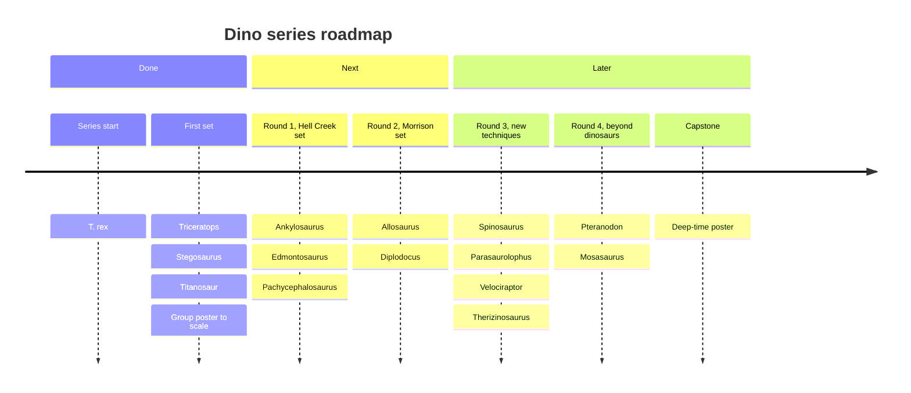

# dino-series

An illustrated dinosaur series in one shared style: cel-shaded vector drawings with dark outlines, stripes, a pale belly, gradient shading, scale texture and a warm rim light. Each dinosaur comes as an animated SVG, a GSAP page, a poster, a rig sheet and an interactive Three.js model.

- [The dinosaurs](#the-dinosaurs)
- [Project layout](#project-layout)
- [Using the drawings](#using-the-drawings)
- [Rebuilding](#rebuilding)
- [Roadmap](#roadmap)
- [Sources](#sources)

## The dinosaurs

| Species | Signature move | Animated SVG | GSAP page | 3D model |
|---|---|---|---|---|
| *Tyrannosaurus rex* | Roar | `svg/trex-animated.svg` | `gsap/trex-gsap.html` | `3d/trex-3d.html` |
| *Triceratops horridus* | Horns-down charge | `svg/triceratops-animated.svg` | `gsap/triceratops-gsap.html` | `3d/triceratops-3d.html` |
| *Stegosaurus stenops* | Spiked tail swing, plates flush red | `svg/stegosaurus-animated.svg` | `gsap/stegosaurus-gsap.html` | `3d/stegosaurus-3d.html` |
| *Patagotitan mayorum* (titanosaur) | Neck raise and call | `svg/titanosaur-animated.svg` | `gsap/titanosaur-gsap.html` | `3d/titanosaur-3d.html` |

Each species also has a poster and a rig sheet in `boards/`, and `boards/Group.dc.html` shows all four together at their real lengths.

## Project layout

```text
dino-series/
├── svg/                       animated SVG, one per species
├── gsap/                      GSAP page per species; click the dinosaur to play its move
├── 3d/                        Three.js model per species; drag to orbit, click to play the move
├── boards/                    posters and rig sheets (*.dc.html) and their canvas layout (canvas.json)
├── src/                       builders
│   ├── dinokit.py             shared toolkit: drawing helpers, motion CSS, poster and rig builders
│   ├── sp_*.py                one builder per species (Triceratops, Stegosaurus, titanosaur)
│   ├── trex_drawing.py        the definitive T. rex drawing
│   ├── trex_svg.py            shading pass over it; writes svg/trex-animated.svg
│   ├── trex_gsap.py, trex_poster.py, trex_rig.py
│   ├── group_poster.py        all four to scale
│   └── triceratops_3d.py      Triceratops 3D page, generated from the T. rex engine
├── baseline/trex-boxy-head/   saved T. rex baseline: head shapes, ids and pivots
├── shots/                     local screenshots (not tracked)
├── CLAUDE.md                  project rules for Claude Code
└── README.md
```

## Using the drawings

Every moving part is its own group with an id. Each group sits inside a wrapper whose origin is the joint, so rotating or scaling with `transform-origin: 0 0` pivots in the right place. In GSAP, use `svgOrigin: "0 0"`.

| Species | Group ids | Class prefix |
|---|---|---|
| T. rex | `#tail` `#body` `#head` `#jaw` `#leg-near` `#leg-far` `#arm-near` `#arm-far` | `tr-` |
| Triceratops | `#act` `#body` `#tail` `#head` `#leg-near` `#leg-far` `#foreleg-near` `#foreleg-far` | `tri-` |
| Stegosaurus | `#act` `#body` `#plates` `#tail` `#head` `#leg-near` `#leg-far` `#foreleg-near` `#foreleg-far` | `stg-` |
| Titanosaur | `#act` `#body` `#tail` `#neck` `#head` `#jaw` `#leg-near` `#leg-far` `#foreleg-near` `#foreleg-far` | `tit-` |

- The standalone SVGs loop on their own. Remove the `<prefix>anim` class from the root `<svg>` to stop the built-in animation and drive the groups yourself.
- `#act` moves the whole animal, for example the Triceratops lunge.
- Each eyelid uses the class `<prefix>eyelid`.

## Rebuilding

Requires Python 3.11+ with `matplotlib`. The screenshot and browser checks also use Playwright and Google Chrome. Run the builders from anywhere; all paths are relative to the repository.

```sh
# T. rex
python3 src/trex_svg.py          # svg/trex-animated.svg, checked against baseline/trex-boxy-head/baseline.json
python3 src/trex_gsap.py         # gsap/trex-gsap.html
python3 src/trex_poster.py       # boards/Main.dc.html
python3 src/trex_rig.py          # boards/Rig.dc.html

# Other species: animated SVG, GSAP page, poster and rig sheet
python3 src/sp_triceratops.py
python3 src/sp_stegosaurus.py
python3 src/sp_titanosaur.py

# Group poster to scale (measures each drawing in a browser)
python3 src/group_poster.py

# Triceratops 3D page, generated from the T. rex engine
python3 src/triceratops_3d.py
```

- `trex_drawing.py` is the definitive T. rex drawing. `trex_svg.py` layers the shading and texture pass over it without changing its shapes, ids or pivots, and stops if any of them change.
- Each animated SVG and its GSAP page carry the identical drawing, so rebuild them together.
- The 3D pages load Three.js 0.160 from jsdelivr and need no build step. When testing offline, serve the folder locally so the module imports resolve.

## Roadmap

Each round reuses the rigs and toolkit built before it, so the order runs from the easiest additions to the biggest new techniques.



| Round | Animals and moves | Extra | Effort |
|---|---|---|---|
| 1. Hell Creek set | Ankylosaurus (tail-club strike), Edmontosaurus (rears up to browse), Pachycephalosaurus (dome head-butt) | Floodplain scene poster with the T. rex and Triceratops | Low to medium |
| 2. Morrison set | Allosaurus (lunge and bite, reuses the T. rex rig), Diplodocus (whip-tail crack, reuses the titanosaur rig) | Jurassic scene poster with the Stegosaurus | Low |
| 3. New techniques | Spinosaurus (sail, swimming pose), Parasaurolophus (crest call with sound rings), Velociraptor (feathers, pounce), Therizinosaurus (giant claws, feathers) | | Medium to high |
| 4. Beyond dinosaurs | Pteranodon (flight and glide cycle), Mosasaurus (underwater swim loop) | Label them as prehistoric reptiles, not dinosaurs | High |
| Capstone | Deep-time poster | Every species on one timeline, Jurassic to end-Cretaceous | Medium |

## Sources

Poster facts were checked in November 2026 against The Canadian Encyclopedia, National Geographic, the Natural History Museum's Dino Directory and the Western Australian Museum, among others. Lengths are estimates for large adults, and Patagotitan's 31–37 m range reflects revised estimates.
