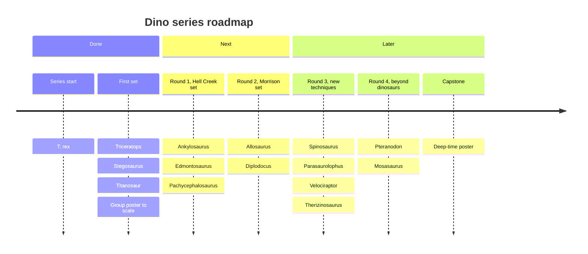

# dino-series

An illustrated dinosaur series in one shared style: cel-shaded vector drawings with outlines, stripes, a pale belly, gradient shading, scale texture and rim light. Each dinosaur comes as an animated SVG, a GSAP page, a poster, a rig sheet and an interactive Three.js model.

| Species | Signature move | Files |
|---|---|---|
| Tyrannosaurus rex | Roar | `trex-animated.svg`, `trex-gsap.html`, `trex-3d.html` |
| Triceratops horridus | Horns-down charge | `triceratops-animated.svg`, `triceratops-gsap.html`, `triceratops-3d.html` |
| Stegosaurus stenops | Spiked tail swing, plates flush | `stegosaurus-animated.svg`, `stegosaurus-gsap.html`, `stegosaurus-3d.html` |
| Patagotitan mayorum (titanosaur) | Neck raise and call | `titanosaur-animated.svg`, `titanosaur-gsap.html`, `titanosaur-3d.html` |

`project/` holds the poster and rig-sheet boards (`*.dc.html`) and their layout (`canvas.json`), including `Group.dc.html`, a poster of all four at their real lengths.

## Roadmap

Each round reuses the rigs and toolkit built before it, so the order runs from the easiest additions to the biggest new techniques.



| Round | Animal | Signature move or focus | Effort |
|---|---|---|---|
| Done | T. rex | Roar | Done |
| Done | Triceratops, Stegosaurus, titanosaur, group poster | Charge, tail swing, neck-up call; all four to scale | Done |
| 1. Hell Creek set | Ankylosaurus | Tail-club strike | Low to medium |
| | Edmontosaurus | Rears up to browse | |
| | Pachycephalosaurus | Dome head-butt | |
| | Floodplain scene poster | With the T. rex and Triceratops | |
| 2. Morrison set | Allosaurus | Lunge and bite (reuses the T. rex rig) | Low |
| | Diplodocus | Whip-tail crack (reuses the titanosaur rig) | |
| | Jurassic scene poster | With the Stegosaurus | |
| 3. New techniques | Spinosaurus | Sail, swimming pose | Medium to high |
| | Parasaurolophus | Crest call with sound rings | |
| | Velociraptor | Feathers, pounce | |
| | Therizinosaurus | Giant claws, feathers | |
| 4. Beyond dinosaurs | Pteranodon | Flight and glide cycle | High |
| | Mosasaurus | Underwater swim loop | |
| Capstone | Deep-time poster | Every species on one timeline, Jurassic to end-Cretaceous | Medium |

Pteranodon and Mosasaurus are prehistoric reptiles, not dinosaurs, and their posters should say so.

## Using the drawings

Every moving part is its own group with an id. Each group sits inside a wrapper whose origin is the joint, so rotating or scaling with `transform-origin: 0 0` pivots in the right place. In GSAP, use `svgOrigin: "0 0"`.

| Species | Group ids | Class prefix |
|---|---|---|
| T. rex | `#tail` `#body` `#head` `#jaw` `#leg-near` `#leg-far` `#arm-near` `#arm-far` | `tr-` |
| Triceratops | `#act` `#body` `#tail` `#head` `#leg-near` `#leg-far` `#foreleg-near` `#foreleg-far` | `tri-` |
| Stegosaurus | `#act` `#body` `#plates` `#tail` `#head` `#leg-near` `#leg-far` `#foreleg-near` `#foreleg-far` | `stg-` |
| Titanosaur | `#act` `#body` `#tail` `#neck` `#head` `#jaw` `#leg-near` `#leg-far` `#foreleg-near` `#foreleg-far` | `tit-` |

The standalone SVGs loop on their own. Remove the `*-anim` class from the root `<svg>` to stop the built-in animation and drive the groups yourself. The eyelid of each species uses the class `<prefix>eyelid`.

## Rebuilding

Requires Python 3.11+ with `matplotlib`. The screenshot and browser checks also use Playwright and Google Chrome.

```sh
python3 build5.py           # T. rex: trex-animated.svg (definitive boxy-head version, checked against versions/boxy-head-definitive/baseline.json)
python3 build_gsap.py       # T. rex GSAP page
python3 build_poster.py     # T. rex poster board
python3 build_rig.py        # T. rex rig sheet
python3 sp_triceratops.py   # each species: SVG, GSAP page, poster and rig board
python3 sp_stegosaurus.py
python3 sp_titanosaur.py
python3 build_group.py      # group poster to scale (measures each drawing in a browser)
```

`dinokit.py` is the shared toolkit for the series: drawing helpers, the motion CSS, and the poster and rig-sheet builders. `build4.py` is the definitive T. rex drawing; `build5.py` layers the shading and texture pass over it without changing its shapes, ids or pivots.

The 3D pages load Three.js 0.160 from jsdelivr and need no build step. Open them in a browser.

## Facts

Poster facts were checked against current sources in November 2026 (Encyclopedia-style references, the Natural History Museum's Dino Directory, the Western Australian Museum and others). Lengths are estimates for large adults; Patagotitan's 31–37 m range reflects revised estimates.
